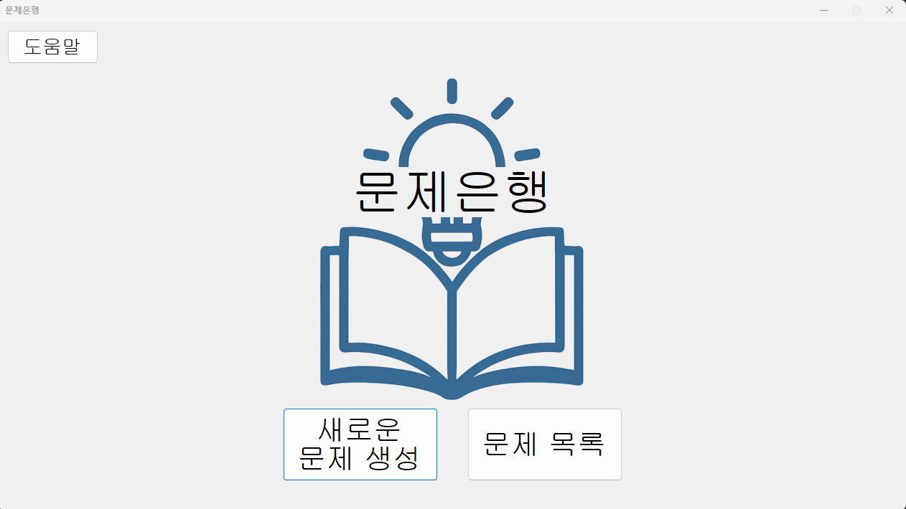
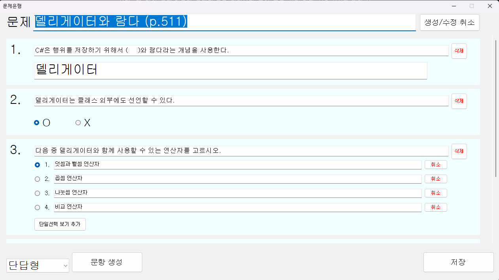
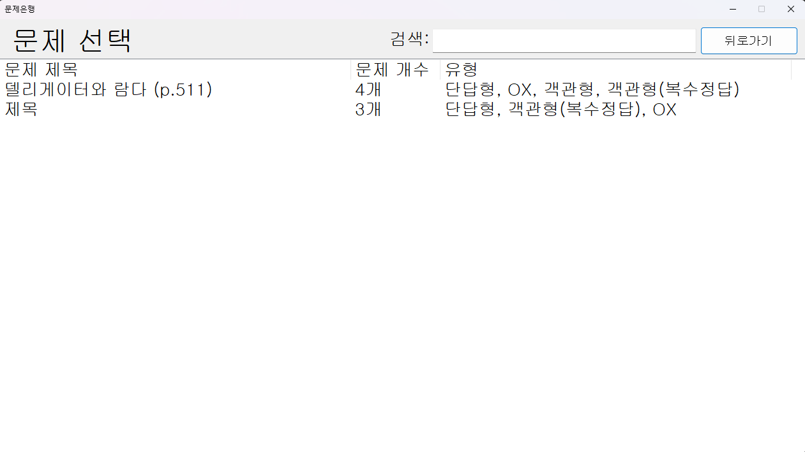
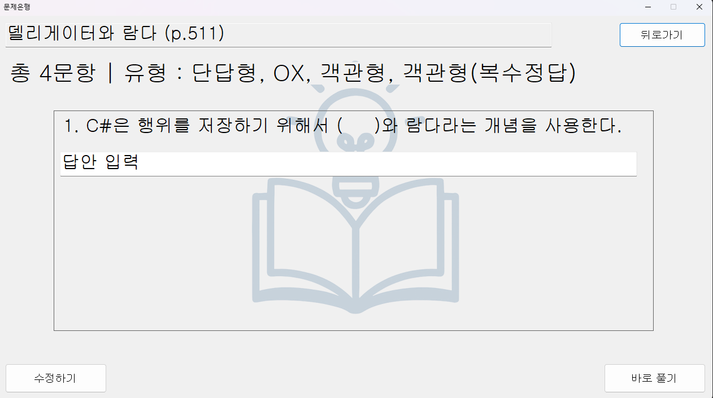
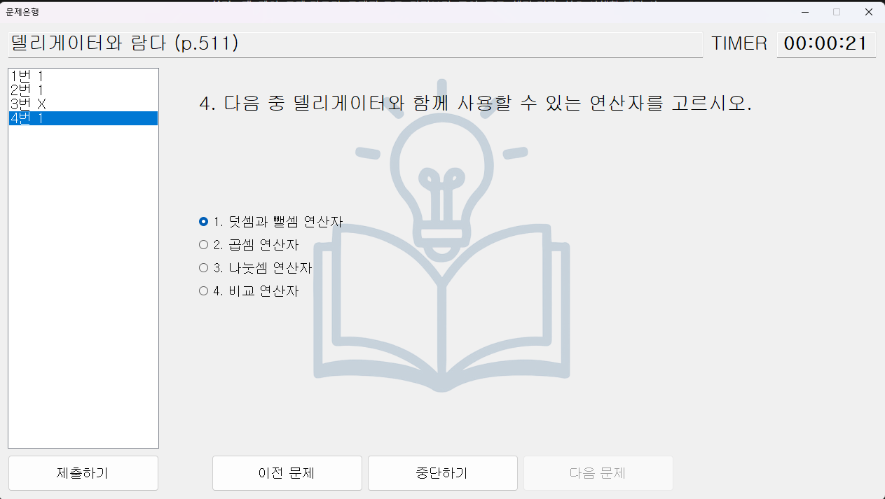
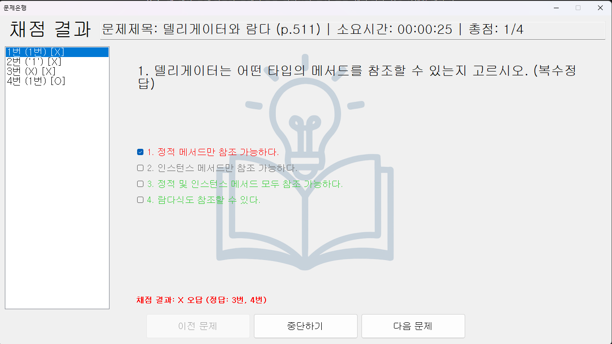

# 문제 출제·풀이 프로그램

문제를 직접 만들고, 저장하고, 풀고, 채점까지 할 수 있는 Windows용 학습 프로그램입니다.

## 화면

| 메인 화면 | 문제 만들기 |
|---|---|
|  |  |

| 문제집 목록 | 미리보기 |
|---|---|
|  |  |

| 풀이 | 채점 결과 |
|---|---|
|  |  |

## 주요 기능

- 문제 만들기: 단답형, OX, 객관식(단일 선택 / 복수 선택)
- 문제 수정과 미리보기
- 문제 세트를 JSON 파일로 저장하고 불러오기
- 문제 풀이와 자동 채점, 결과 확인

## 사용 기술

- C#, Windows Forms (.NET Framework)
- System.Text.Json (문제 세트 저장)
- Visual Studio

## 구조

| 파일 | 역할 |
|---|---|
| `QuestionData.cs` | 문제 데이터. 공통 부모 `BaseQuestionData`를 유형별 클래스가 상속 |
| `ProblemForm.cs` | 문제 만들기·수정 화면 |
| `PreviewForm.cs` | 미리보기 화면 |
| `SolveListForm.cs`, `QuizForm.cs` | 문제 세트 선택, 풀이 화면 |
| `GradingForm.cs`, `EndForm.cs` | 채점, 결과 화면 |
| `*Control.cs` | 문제 유형별 입력·풀이 컨트롤 |

## 실행 방법

Visual Studio에서 `team_project.slnx`를 열고 실행(F5)합니다.

기능은 직접 기획하고 AI 코딩 도구를 활용해 구현했습니다.
